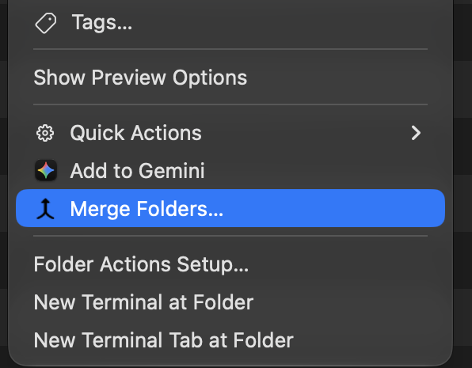
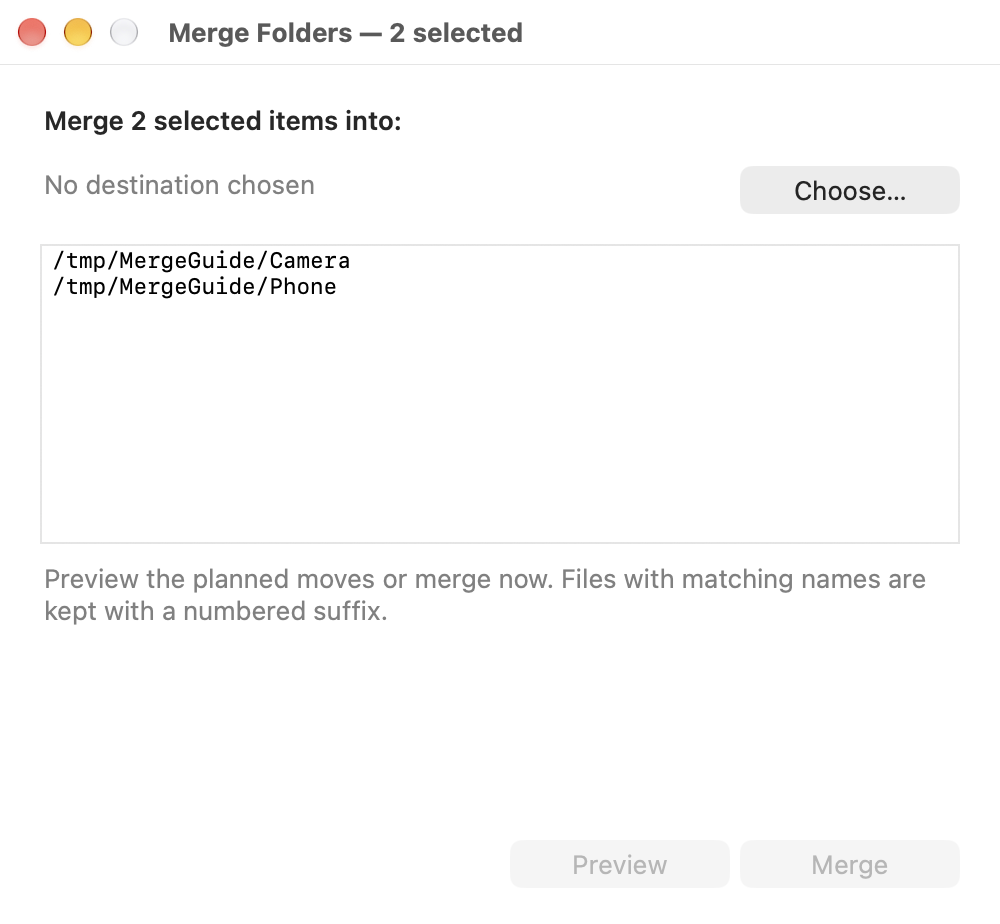
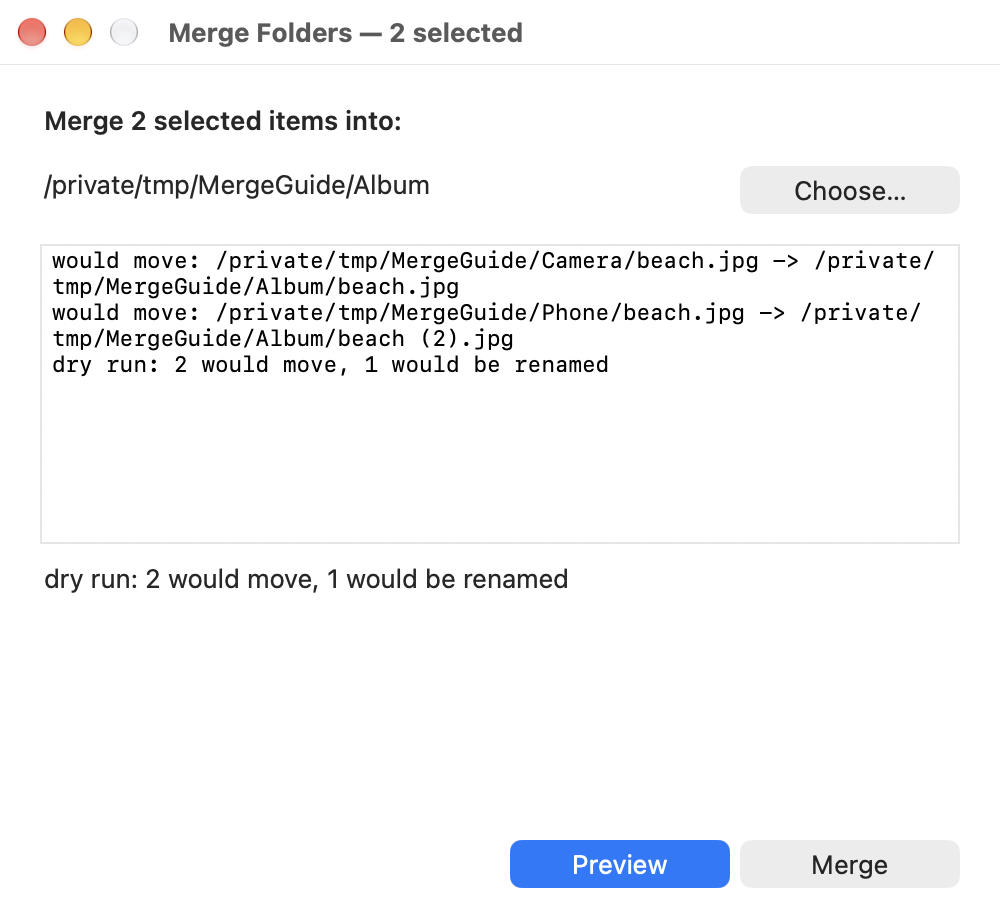

<p align="center"></p>

# Merge Folders for macOS

Combine folders from Finder or Terminal. If two folders contain `Trips/beach.jpg`, the first photo keeps its name and the incoming photo becomes `Trips/beach (2).jpg`. The app **moves** the originals. Use Preview in Finder or the Terminal example below to see the planned moves before changing your files.

[](https://github.com/Davin-X/mergefolders/releases/latest)

[Illustrated guide](https://davin-x.github.io/mergefolders/) · [Installation](#install) · [Finder walkthrough](#merge-from-finder) · [Terminal quick start](#try-the-cli-with-sample-files) · [File handling](#what-happens-to-my-files) · [Uninstall](#update-or-uninstall)

## Install

Merge Folders requires macOS 13 or later and runs on Apple silicon and Intel Macs.

**Ready-made app (Finder menu and Terminal command).** Download `MergeFolders-<version>.zip` from the [latest release](https://github.com/Davin-X/mergefolders/releases/latest), unzip it, and move **MergeFolders.app** to Applications. Open it once, then follow [Merge from Finder](#merge-from-finder). If macOS says the app cannot be verified, open **System Settings → Privacy & Security** and click **Open Anyway**. Releases signed with a Developer ID open without this step. The Terminal command is inside the app; to use it, run `ln -s /Applications/MergeFolders.app/Contents/Resources/mergefolders ~/bin/mergefolders`.

**Homebrew (Terminal command).** Run `brew install Davin-X/tap/mergefolders`.

**From source.** Download the source ZIP from the [latest release](https://github.com/Davin-X/mergefolders/releases/latest), or use **Code → Download ZIP** on the repository page, and unzip it. In Terminal, type `cd ` (including the space), drag the extracted folder into the window, press Return, then choose:

| What you want | Run in Terminal | Installed location |
| --- | --- | --- |
| Finder menu and Terminal command | `./install.sh` | `/Applications/MergeFolders.app` and `~/bin/mergefolders` |
| Terminal command only | `./install.sh --cli-only` | `~/bin/mergefolders` |

Building the Finder app needs write access to `/Applications` and Apple’s Command Line Tools. To install the tools, run `xcode-select --install`, finish the Apple installer, then run `./install.sh`. The CLI-only option uses the Bash and file utilities included with macOS and skips compilation.

Run `mergefolders --version`, or open the app, to see which version you have.

## Merge from Finder

1. Open **System Settings**, search for **Extensions**, find **Finder Extensions**, and enable **Merge Folders**. The settings location varies by macOS version.
2. In a Finder window, Command-click the source folders or files. Right-click the selection and choose **Merge Folders…**.

   

3. **Choose the destination.** Check that Camera and Phone are both listed. Click **Choose…** and select or create the Album folder.

   

4. **Preview the names.** Click **Preview**. The last planned path ends in `beach (2).jpg`, so both photos will be kept. The dry run leaves the sources in place.

   

5. **Merge and inspect the result.** Click **Merge**. In this example the summary reports two files moved, one renamed, and zero failures. Click **Open Folder** to see both photos, **Undo Merge** to put every file back where it was, or **Done** to close the window.

   

If the menu is missing, open **MergeFolders** from Applications, use **Open Finder Extensions…**, and check the switch. Reopen the Finder window after enabling it.

## Try the CLI with sample files

Paste this into Terminal. It creates a fresh practice folder with two files of the same name and previews the merge.

```sh
demo=$(mktemp -d)
mkdir -p "$demo/First" "$demo/Second" "$demo/Merged"
printf 'first copy\n' > "$demo/First/note.txt"
printf 'second copy\n' > "$demo/Second/note.txt"
~/bin/mergefolders --dry-run --to "$demo/Merged" "$demo/First" "$demo/Second"
```

To perform the merge and see both files, run these commands in the same Terminal window.

```sh
~/bin/mergefolders --to "$demo/Merged" "$demo/First" "$demo/Second"
ls "$demo/Merged"
```

The destination now contains `note.txt` and `note (2).txt`. For your own files, replace the three folder paths. Put paths containing spaces in quotes. You can also drag folders from Finder into Terminal to enter their paths.

| Option | Use |
| --- | --- |
| `--to DIR` | Merge into an existing directory. Omit this option to choose one in a dialog. |
| `--dry-run`, `-n` | Preview planned file moves and names. |
| `--keep` | Leave the source directory structure in place after moving its files. |
| `--notify` | Display a macOS notification on completion or a dialog on failure. |
| `--undo [LOG]` | Move the files from the last merge back. Pass the `undo log:` path a merge printed to undo that merge specifically. |
| `--version` | Print the version and exit. |
| `--help` | Print usage and exit. |

## What happens to my files?

- Files retain their relative paths. Same-named subdirectories combine. A naming conflict adds the first available suffix, starting at ` (2)`, before the last extension.
- Selected symbolic links move as links. Relative links keep their stored target text, so moving one can change where it resolves. A symlink beneath the destination cannot serve as a parent for incoming files.
- Empty source directories are pruned after a move unless you use `--keep`. Empty directories are not created in the destination. Finder’s `.DS_Store` files inside sources are skipped.
- You can select the destination as one of the source folders. The tool skips it. A destination nested inside another source is rejected.
- Every merge records its moves in `~/Library/Logs/MergeFolders/` and prints the log path. `mergefolders --undo` (or **Undo Merge** in the app) moves each file back to its original path and removes folders the merge created in the destination once they are empty. Files that were since deleted, or whose original path is now taken, are reported and left alone. Empty folders and Finder’s `.DS_Store` files removed from the sources are not recreated.
- A merge performs individual moves. If it stops partway, completed moves stay in place and can be undone the same way. A source that cannot be fully listed is left untouched, and the rest still merge. Keep a backup when merging important files.
- Download cloud-only files before merging. For a Finder merge, diagnostic output is saved to `~/Library/Logs/MergeFolders.log`.

## Update or uninstall

To update, use the method you installed with: download the new app from the [latest release](https://github.com/Davin-X/mergefolders/releases/latest) and replace the old one, run `brew upgrade mergefolders`, or download the new source and rerun the installation command. When you open the app from Applications, it tells you if a newer release exists. Merge windows never check.

To uninstall the Finder integration, quit Merge Folders, disable its Finder extension in System Settings, and run the following commands. Unregister the extension while the app is still installed.

```sh
pluginkit -r "/Applications/MergeFolders.app/Contents/PlugIns/MergeFoldersExt.appex"
```

Move **MergeFolders.app** from Applications to the Trash. To remove the Terminal command, run `rm -i "$HOME/bin/mergefolders"`.

## Development and release checks

```sh
bash tests/test_mergefolders.sh
bash finder/build.sh --build-only
```

The second command compiles a universal (Apple silicon and Intel) app at `finder/build/MergeFolders.app` and signs it ad hoc. Set `SIGN_IDENTITY="Developer ID Application: …"` to sign it for notarization instead. CI verifies the signature, both architectures, the extension linkage, and the bundled CLI.

The version lives only in the `VERSION=` line of `mergefolders`; the build copies it into the app. To release:

1. Bump `VERSION=` in `mergefolders`, commit, and push a matching tag: `git tag v0.3.0 && git push origin v0.3.0`.
2. The **release** workflow runs the tests, builds the app, and publishes a GitHub release with `MergeFolders-<version>.zip`, the `mergefolders` script, `SHA256SUMS`, and a filled-in Homebrew formula `mergefolders.rb`.
3. Copy `mergefolders.rb` into `Formula/` of the `Davin-X/homebrew-tap` repository (create it once, public, named exactly `homebrew-tap`).

To ship a signed, notarized app, add these repository secrets: `MACOS_CERT_P12` (base64 of an exported Developer ID Application certificate), `MACOS_CERT_PASSWORD`, `APPLE_ID`, `APPLE_TEAM_ID`, and `APPLE_APP_PASSWORD` (an app-specific password). The workflow then signs with the hardened runtime, notarizes, staples, and also attaches a Homebrew cask, `mergefolders-app.rb`, for `Casks/` in the tap.

Before tagging a release, test the documented install on a Mac, enable the Finder extension, and merge two disposable folders containing a same-named file. Confirm both contents in the destination, then test removal.

## Publish the GitHub Pages guide

The illustrated guide lives in [docs/index.html](docs/index.html). In the GitHub repository, open **Settings → Pages → Build and deployment → Source** and select **GitHub Actions**. Push the source to `main`, or run **Documentation** from the Actions tab. The workflow publishes the guide and a downloadable ZIP of that exact commit. The deployment summary shows the live URL. Add that URL to the repository’s **About → Website** field so visitors can find it.

To preview the design locally, open `docs/index.html` in a browser. To test the download for the current commit, run:

```sh
git archive --format=zip --prefix=mergefolders/ -o docs/mergefolders-source.zip HEAD
```

[MIT license](LICENSE)
