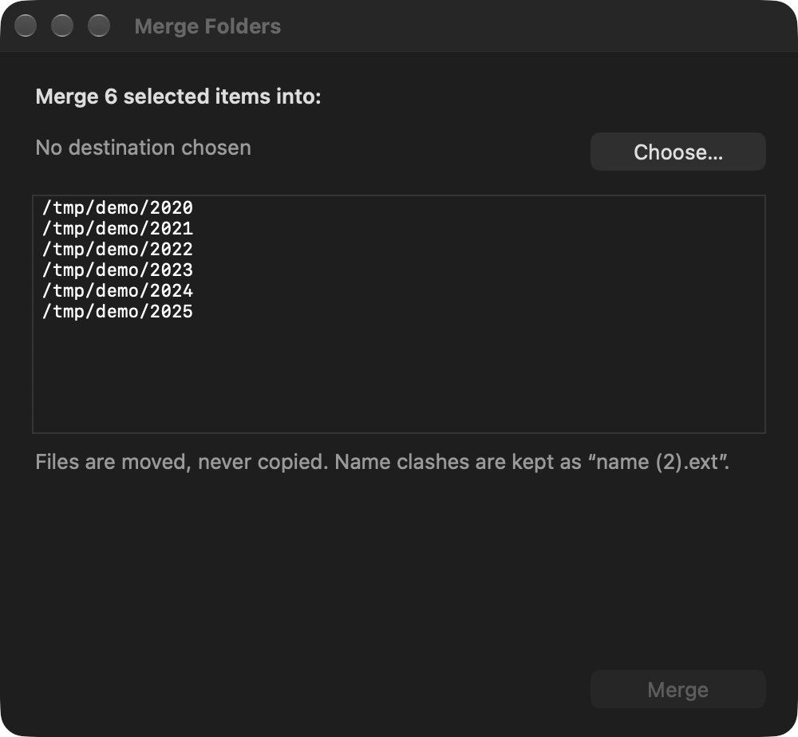

<p align="center">
  
</p>

<h1 align="center">Merge Folders</h1>

<p align="center">
  Move the contents of several folders into one — same-named files are kept, never overwritten.<br>
  A Finder right-click item and a command-line tool, sharing the same script.
</p>

<p align="center">
  <a href="https://github.com/Davin-X/mergefolders/actions/workflows/test.yml"></a>
  
  
</p>

<p align="center">
  
</p>

## Why

- **Nothing is overwritten.** A clash becomes `name (2).ext` — `beach.jpg` → `beach (2).jpg` → `beach (3).jpg`.
- **Folders merge by relative path.** Same-named subfolders combine instead of replacing each other.
- **Real moves, not copies.** Empty source folders are removed when done (use `--keep` to keep them).
- **Safe under concurrency.** One merge per destination at a time, so two Finder invocations can't corrupt the rename numbering.

## Install

Requires macOS 13 or later and the Xcode command-line tools.

```sh
git clone https://github.com/Davin-X/mergefolders.git
cd mergefolders
./install.sh
```

This installs `mergefolders` to `~/bin` and builds **MergeFolders.app** into `/Applications`, ad-hoc signed and registered with the Finder extension system.

Then enable it: **System Settings → General → Login Items & Extensions → Finder Extensions → Merge Folders**.

## Use

**Finder:** select two or more folders (or files) → right-click → **Merge Folders…** → choose the destination → **Merge**.

**Terminal:**

```sh
mergefolders --to ~/Pictures/Merged ~/Pictures/2023 ~/Pictures/2024

# preview only
mergefolders --dry-run --to ~/Pictures/Merged ~/Pictures/2023
```

| flag | meaning |
| --- | --- |
| `--to DIR` | destination folder (default: ask with a Finder dialog) |
| `--dry-run` | print the plan, change nothing |
| `--keep` | keep empty source folders |
| `--notify` | macOS notification when done |

## How it works

Each selected folder is walked, and every file moves to the same relative path inside the destination. Same-named subfolders combine; a file that is already there is renamed instead of replaced.

```text
Before
2023/                 2024/
  beach.jpg             beach.jpg
  sunset.jpg            hike.jpg

mergefolders --to Photos 2023 2024

After
Photos/
  beach.jpg            from 2023
  beach (2).jpg        from 2024 — clash kept
  sunset.jpg
  hike.jpg
```

Hidden files keep their leading dot, so a clash on `.config.json` becomes `.config (2).json` — never `.config.json (2)`.

A few details that matter in practice:

- **Same volume:** the move is an atomic rename.
- **Cross volume:** files are copied with metadata (tags and extended attributes) and the source is deleted only after the copy succeeds.
- **Locking:** a destination-keyed lock makes concurrent merges wait, then fail cleanly instead of racing on `name (2)` numbering.
- **`.DS_Store`** is dropped, not merged.

## Development

```sh
bash tests/test_mergefolders.sh
```

The suite covers rename formats (including hidden and multi-dot names), the sibling-prefix destination check, and refusal to merge a destination into its own source. CI runs it on macOS together with a Swift typecheck of both apps.

```text
mergefolders   command-line script (bash 3.2 compatible)
finder/        Finder Sync extension + host app (Swift), icon, build script
tests/         shell tests
assets/        README and social-preview images
```

## Limitations

- No undo — keep-both renaming is the safety net.
- The app is ad-hoc signed, so there is no notarized download: build it locally with `./install.sh`.
- Download iCloud/Dropbox placeholders before moving them.

## Uninstall

```sh
rm ~/bin/mergefolders
rm -rf /Applications/MergeFolders.app
pluginkit -a "/Applications/MergeFolders.app/Contents/PlugIns/MergeFoldersExt.appex"
```

## License

[MIT](LICENSE) © 2026 Devendra Kumar
