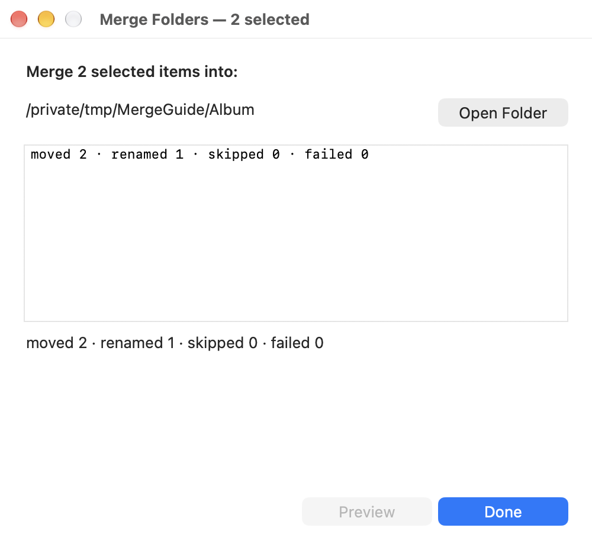

<p align="center"></p>

<h1 align="center">Merge Folders for macOS</h1>

<p align="center">
Combine folders from Finder or Terminal without losing a single file.<br>
<a href="https://github.com/Davin-X/mergefolders/releases/latest"></a>

<a href="LICENSE"></a>
</p>

<p align="center">
<a href="https://davin-x.github.io/mergefolders/">Illustrated guide</a> ·
<a href="#install">Install</a> ·
<a href="#merge-from-finder">Finder</a> ·
<a href="#merge-from-terminal">Terminal</a> ·
<a href="#what-happens-to-my-files">Safety</a> ·
<a href="#update-or-uninstall">Uninstall</a>
</p>

Finder's own merge keeps only one of two files that share a name. Merge Folders keeps both: if two folders contain `Trips/beach.jpg`, the first keeps its name and the second becomes `Trips/beach (2).jpg`.

- **Nothing is overwritten.** Same-named files get a numbered suffix; same-named subfolders combine.
- **Preview first.** See every planned move before anything changes.
- **Undo.** Every merge is logged and can be moved back with one click.
- **Safe to cancel.** The file in flight finishes and is logged, so Undo still restores everything.

Files are **moved**, not copied, so the source folders end up empty and are removed.

## Install

Requires macOS 13 or later, on Apple silicon or Intel.

| You want | Do this |
| --- | --- |
| **Finder menu** (and Terminal) | Download `MergeFolders-<version>.zip` from the [latest release](https://github.com/Davin-X/mergefolders/releases/latest), unzip it, move **MergeFolders.app** to Applications, and open it once. |
| **Terminal only** | `brew install Davin-X/tap/mergefolders` |
| **Build it yourself** | See [From source](#from-source). |

The app is not notarized yet. If macOS says it cannot be verified, open **System Settings → Privacy & Security** and click **Open Anyway**.

To also use the app's Terminal command, link it into `~/bin`:

```sh
mkdir -p ~/bin && ln -s /Applications/MergeFolders.app/Contents/Resources/mergefolders ~/bin/mergefolders
```

If Terminal then says `command not found: mergefolders`, add `~/bin` to your PATH once and open a new window:

```sh
echo 'export PATH="$HOME/bin:$PATH"' >> ~/.zprofile
```

Check your version with `mergefolders --version`, or open the app.

## Merge from Finder

1. **Turn on the menu.** Open **System Settings**, search for **Extensions**, open **Finder Extensions**, and switch on **Merge Folders**. (The app's **Open Finder Extensions…** button goes straight there.)
2. **Select the folders.** Command-click the source folders in Finder, right-click, and choose **Merge Folders…**.

   

3. **Choose the destination.** Check that both folders are listed, click **Choose…**, and pick or create the destination folder.

   

4. **Preview.** Click **Preview** to see where each file will go. Here the second `beach.jpg` will become `beach (2).jpg`. Nothing moves yet.

   

5. **Merge.** Click **Merge**. The summary shows what moved, what was renamed, and any failures. Then click **Open Folder** to see the result, **Undo Merge** to put everything back, or **Done**.

   

Menu missing? Make sure the extension is switched on, then close and reopen the Finder window.

## Merge from Terminal

Try it on throwaway files first. This creates two folders that each hold a `note.txt` and previews the merge:

```sh
demo=$(mktemp -d)
mkdir -p "$demo/First" "$demo/Second" "$demo/Merged"
printf 'first copy\n' > "$demo/First/note.txt"
printf 'second copy\n' > "$demo/Second/note.txt"
mergefolders --dry-run --to "$demo/Merged" "$demo/First" "$demo/Second"
```

Now merge for real and look at the result:

```sh
mergefolders --to "$demo/Merged" "$demo/First" "$demo/Second"
ls "$demo/Merged"        # note.txt  note (2).txt
mergefolders --undo      # and put them back
```

For your own files, swap in your folder paths. Quote paths with spaces, or drag folders from Finder into Terminal.

| Option | What it does |
| --- | --- |
| `--to DIR` | Merge into this folder. Without it, a dialog asks. |
| `--dry-run`, `-n` | Show the planned moves; change nothing. |
| `--keep` | Keep the emptied source folders. |
| `--notify` | Show a macOS notification when done, or a dialog on failure. |
| `--undo [LOG]` | Move the last merge back, or the merge recorded in `LOG` (the `undo log:` path a merge prints). |
| `--version`, `--help` | Print the version or usage. |

## What happens to my files?

**Naming.** Files keep their paths relative to the source folder, and same-named subfolders combine. On a clash the incoming file gets the first free suffix, starting at ` (2)`, before the extension: `beach (2).jpg`, `beach (3).jpg`.

**Folders.** Empty folders move too. Sources left empty after the merge are removed, unless you use `--keep`. Finder's hidden `.DS_Store` files are skipped.

**Undo.** Each merge is logged in `~/Library/Logs/MergeFolders/`. **Undo Merge** or `mergefolders --undo` moves every file back and removes folders the merge created, once they are empty. A file that was since deleted, or whose old path is now taken, is reported and left alone; free the path and run the same undo again. Logs older than 90 days are deleted.

**Stopping partway.** Moves happen one at a time. If a merge stops or you cancel it, finished moves stay in place and can still be undone. A source that cannot be fully read is left untouched while the others merge.

**Edge cases.**
- The destination may be one of the selected folders; it is skipped as a source. A destination *inside* a source is refused.
- Symbolic links move as links. A relative link keeps its text, so it may point somewhere else after the move.
- Cloud-only files (iCloud, Dropbox) must be downloaded first.
- Keep a backup of anything irreplaceable.

Finder merges write diagnostics to `~/Library/Logs/MergeFolders.log`.

## Update or uninstall

**Update.** The app tells you when a newer release exists: every time you open it from Applications, and at most once a week in the merge window. Replace the app with the new download, run `brew upgrade mergefolders`, or rerun the source install.

**Uninstall the app.** Quit Merge Folders, switch off its Finder extension, then, while the app is still in Applications, run:

```sh
pluginkit -r "/Applications/MergeFolders.app/Contents/PlugIns/MergeFoldersExt.appex"
```

Then move **MergeFolders.app** to the Trash.

**Uninstall the Terminal command.** Run `brew uninstall mergefolders`, or `rm -i ~/bin/mergefolders` if you installed it another way.

## From source

Download the source ZIP from the [latest release](https://github.com/Davin-X/mergefolders/releases/latest) and unzip it. In Terminal, type `cd ` (with a space), drag the folder into the window, press Return, and run one of:

```sh
./install.sh              # Finder app in /Applications + ~/bin/mergefolders
./install.sh --cli-only   # just ~/bin/mergefolders, no compiling
```

Building the app needs write access to `/Applications` and Apple's Command Line Tools (`xcode-select --install`).

## Development and releases

```sh
bash tests/test_mergefolders.sh      # CLI tests
bash finder/build.sh --build-only    # universal app at finder/build/MergeFolders.app
```

The build signs ad hoc; set `SIGN_IDENTITY="Developer ID Application: …"` to sign for notarization. CI checks the signature, both architectures, the extension and the bundled CLI.

The version lives only in the `VERSION=` line of `mergefolders`. To release:

1. Bump `VERSION=`, commit, and push a matching tag: `git tag v0.3.0 && git push origin v0.3.0`.
2. The **release** workflow tests, builds, and publishes `MergeFolders-<version>.zip`, the `mergefolders` script, `SHA256SUMS`, and a filled-in `mergefolders.rb`.
3. Copy `mergefolders.rb` into `Formula/` of [Davin-X/homebrew-tap](https://github.com/Davin-X/homebrew-tap).

For a signed, notarized app, add the repository secrets `MACOS_CERT_P12` (base64 Developer ID Application certificate), `MACOS_CERT_PASSWORD`, `APPLE_ID`, `APPLE_TEAM_ID`, and `APPLE_APP_PASSWORD`. The workflow then signs with the hardened runtime, notarizes, staples, and also attaches a cask, `mergefolders-app.rb`, for `Casks/` in the tap.

Before tagging, install on a real Mac, enable the Finder extension, merge two throwaway folders that share a file name, check the result, undo it, and test uninstalling.

### GitHub Pages guide

The guide is [docs/index.html](docs/index.html) and deploys from `main` through the **Documentation** workflow (Settings → Pages → Source: **GitHub Actions**). Open the file in a browser to preview it. To test the source download locally:

```sh
git archive --format=zip --prefix=mergefolders/ -o docs/mergefolders-source.zip HEAD
```

[MIT license](LICENSE)
